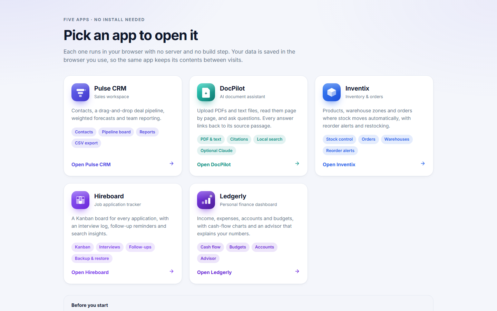
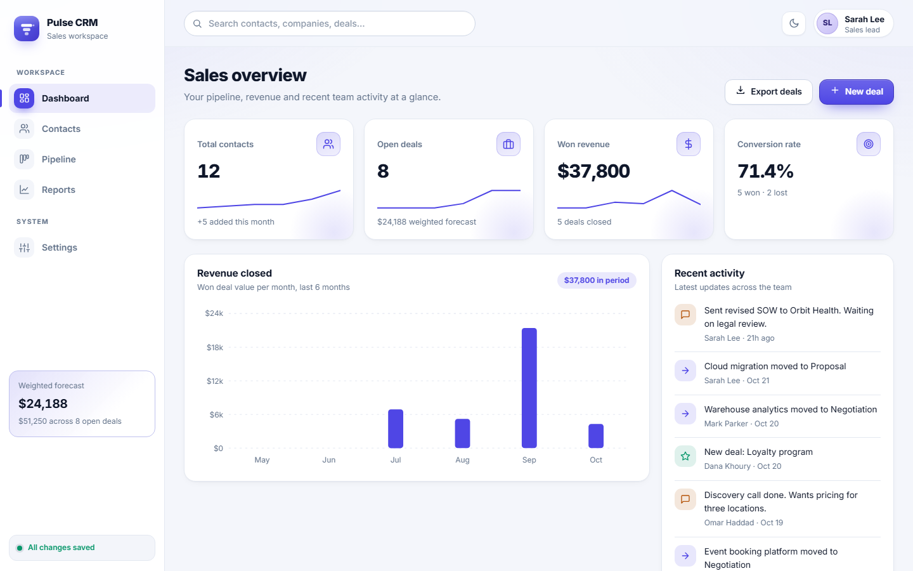
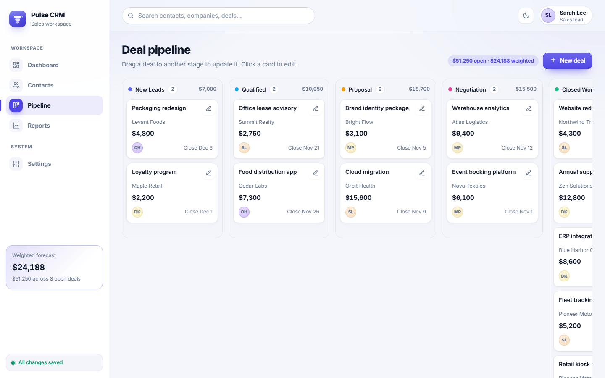
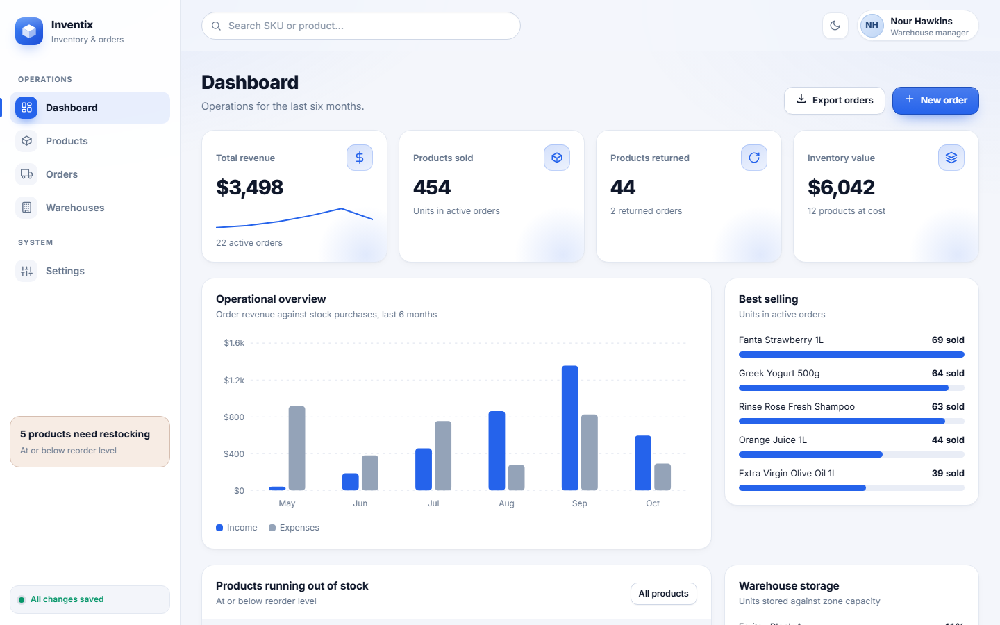
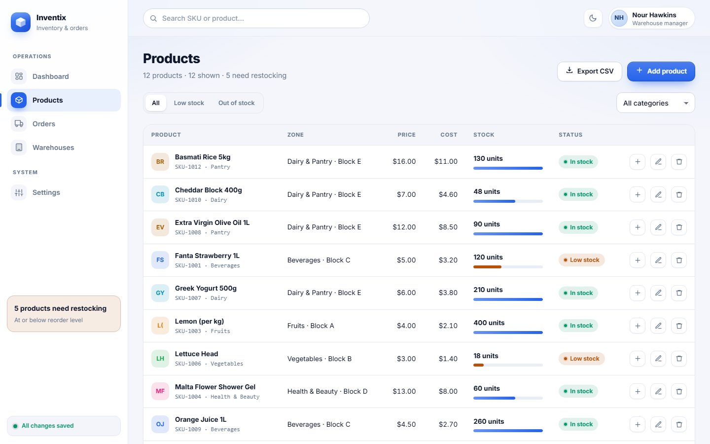
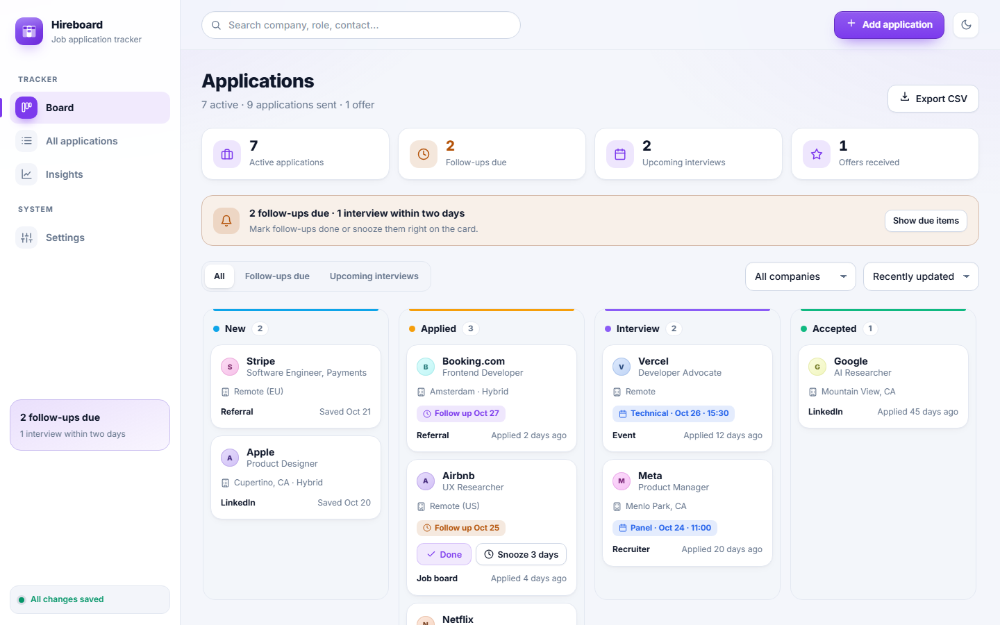
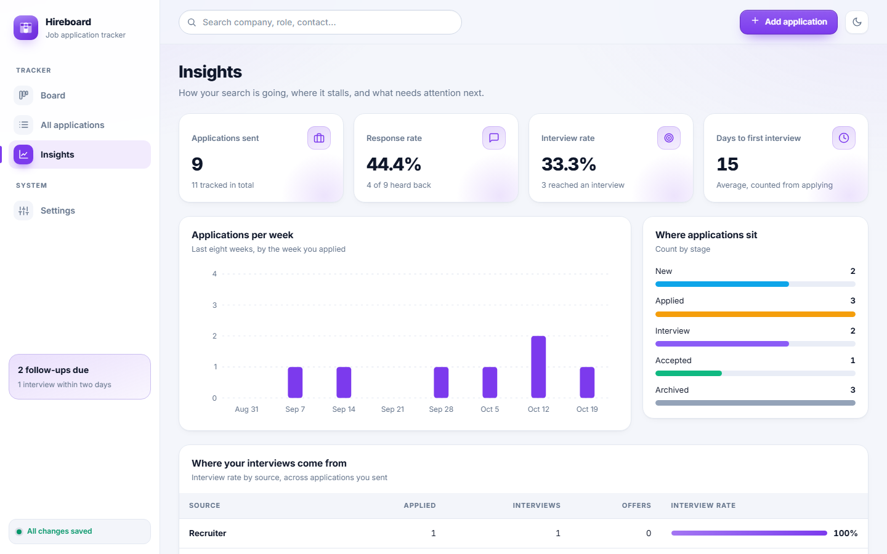
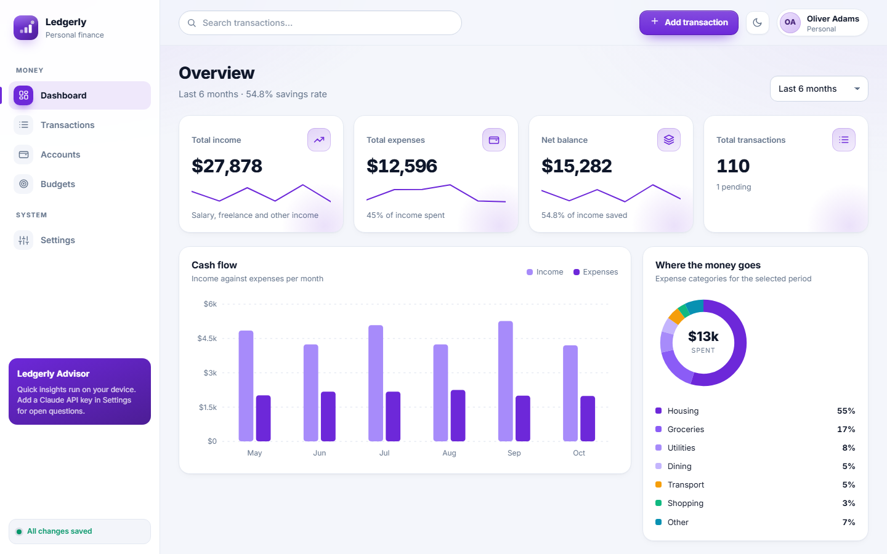
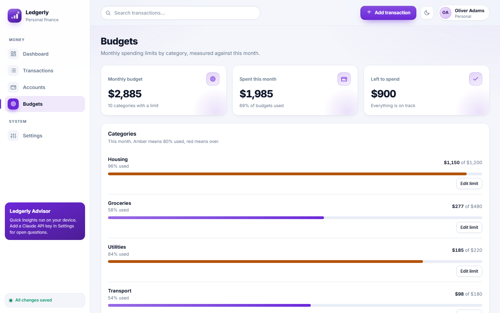
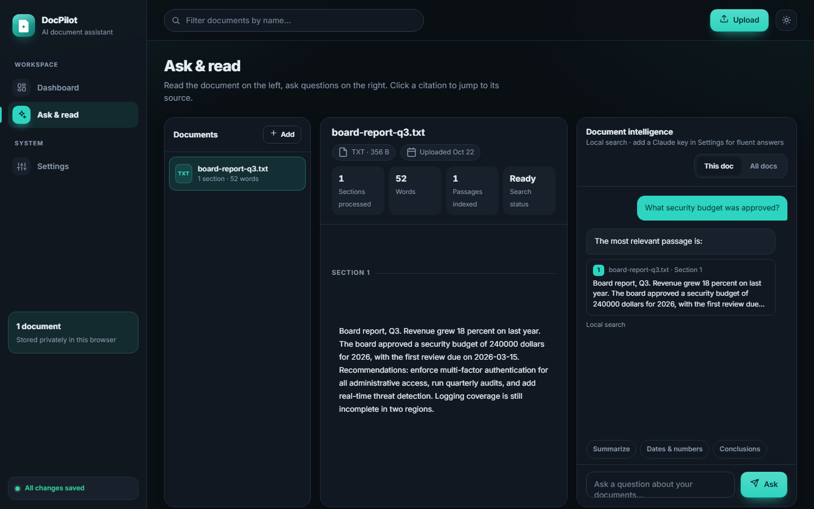

# Five business apps: CRM, document assistant, inventory, job tracker and personal finance

[](https://github.com/sami1507/five-apps/actions/workflows/ci.yml)


Five complete web applications, each with a polished interface, a validated backend and its own business rules. They are built with plain HTML, CSS and JavaScript, and the server uses only the Node.js standard library, so there is nothing to install beyond Node.js itself.

Each app works as a real product: it saves to the server, checks every change, can be installed as an app, and still runs when the server is off.



## The apps

| App | What it does | Highlights |
| --- | --- | --- |
| **Pulse CRM** | Contacts, deal pipeline and sales reporting | Drag-and-drop pipeline, weighted forecast, activity log, team performance |
| **DocPilot** | AI document assistant | Reads PDF and text files, answers questions with clickable citations, optional Claude answers |
| **Inventix** | Inventory and orders | Orders reserve stock automatically, low-stock alerts, warehouse capacity, restocking |
| **Hireboard** | Job application tracker | Kanban board, interview log, follow-up reminders, source analytics, calendar export |
| **Ledgerly** | Personal finance | Accounts, income and expenses, monthly budgets, cash flow, spending breakdown |

### Screenshots

| | |
| --- | --- |
|  |  |
|  |  |
|  |  |
|  |  |
|  | |

## Quick start

Requires **Node.js 20 or newer** (no packages to install).

```bash
git clone https://github.com/sami1507/five-apps.git
cd five-apps
npm start
```

Open <http://localhost:3000>. On first use each app loads realistic sample data, saved to `data/` in the project folder.

**Windows:** double-click `Start Apps.bat`. It starts the server and opens the launcher.

To start over, use **Settings → Restore demo data** in any app, or delete the `data/` folder while the server is stopped.

## Features at a glance

**Storage and sync**
- Every change is sent to the server as a batch. The server validates the whole batch and applies it atomically, so an invalid change never reaches the stored data.
- A status badge in each sidebar shows whether changes are saved.

**Validation and business rules**
- Field-level checks: types, ranges, enums, real calendar dates, email addresses, length limits, duplicate ids.
- Cross-record rules: a deal must point at a real contact, a transaction's category must match its type, stock can never go negative, budgets apply only to expense categories.
- Rejected changes return `422` with the path and reason for each problem.

**Installable and offline**
- Each app has a web manifest and a service worker, so it can be installed from Chrome or Edge and opens offline once visited.
- Opening an app straight from disk (`file://`) still works. It keeps its data in the browser instead of on the server.

**Calendar and reminders (Hireboard)**
- Download a `.ics` file of follow-ups and interviews for Google Calendar, Outlook or Apple Calendar.
- One-click *Add to Google Calendar* for each interview and follow-up.
- Optional browser notifications for due follow-ups.

**Documents and AI (DocPilot)**
- Extracts text from PDF (via PDF.js) and text files, splits it into passages with page numbers, and ranks them with BM25 in the browser.
- Answers cite their passages. Clicking a citation jumps to the source.
- With your own Claude API key (set in Settings), answers are written by Claude from the cited passages. The key stays in your browser.

## Architecture

```
browser (5 apps)  ──  shared/store.js  ──  HTTP/JSON  ──  server (Node.js, no dependencies)
                                                              │
                        validation · business rules · summaries │  atomic writes
                                                              ▼
                                                      data/<app>.json
```

The full picture, including the sync protocol, the security measures and the trade-offs, is in [docs/ARCHITECTURE.md](docs/ARCHITECTURE.md).

## API

Every app has its own endpoints under `/api/<app>/`:

| Method | Path | Purpose |
| ------ | ---- | ------- |
| GET | `/api/health` | Health check |
| GET | `/api/apps` | List of apps and whether each has data |
| GET | `/api/{app}/state` | The app's full document |
| POST | `/api/{app}/sync` | Apply a validated batch of changes |
| GET | `/api/{app}/summary` | Key figures computed on the server |
| GET | `/api/job-tracker/calendar.ics` | Calendar feed |

```bash
curl http://localhost:3000/api/finance/summary
```

The complete reference, with request examples and each app's rules, is in [docs/API.md](docs/API.md).

## Testing

```bash
npm test
```

The suite runs on Node's built-in test runner and covers:
- the validation rules, the persistence layer and the calendar format;
- every app's business rules and summaries;
- the HTTP API end to end, on a real port with temporary data: initialisation, syncing, rejected changes, restart persistence, reset, security headers and path-traversal protection.

The suite is written for Node.js 20 and newer and has been run on Node 24.

GitHub Actions runs the suite on Node 20, 22 and 24 for every push and pull request.

## Configuration

| Variable | Default | Purpose |
| -------- | ------- | ------- |
| `PORT` | `3000` | Port to listen on |
| `HOST` | `127.0.0.1` | Address to bind. Use `0.0.0.0` only on a network you trust |
| `DATA_DIR` | `./data` | Where the app documents are stored |

## Project structure

```
five-apps/
├── server/
│   ├── index.js          entry point
│   ├── app.js            HTTP routing, static files, security headers, logging
│   ├── service.js        init, sync, reset, summaries, feeds
│   ├── schema.js         validation rules (field-level)
│   ├── store.js          atomic JSON document storage
│   ├── apps/             one module per app: schema, business rules, summary
│   └── lib/              calendar (.ics) and date helpers
├── public/
│   ├── index.html        launcher
│   ├── shared/           design system, UI helpers, store sync layer
│   ├── crm/  inventory/  job-tracker/  finance/  doc-assistant/
├── test/                 unit, business-rule and HTTP tests
├── scripts/build-pwa.js  regenerates manifests and service workers
├── docs/                 API, architecture and screenshots
└── .github/workflows/    continuous integration
```

## Working on the frontend

After changing anything under `public/`, regenerate the installable-app files so the offline cache picks up the change:

```bash
npm run build:pwa
```

## Limits (on purpose)

This is a portfolio project, so a few things are deliberately simple. The [architecture notes](docs/ARCHITECTURE.md#trade-offs-and-what-i-would-change-next) list them with the changes I would make before a real launch: authentication, version checks for concurrent edits, a database instead of JSON files, and pagination for large datasets.

## License

[MIT](LICENSE) © sami1507
